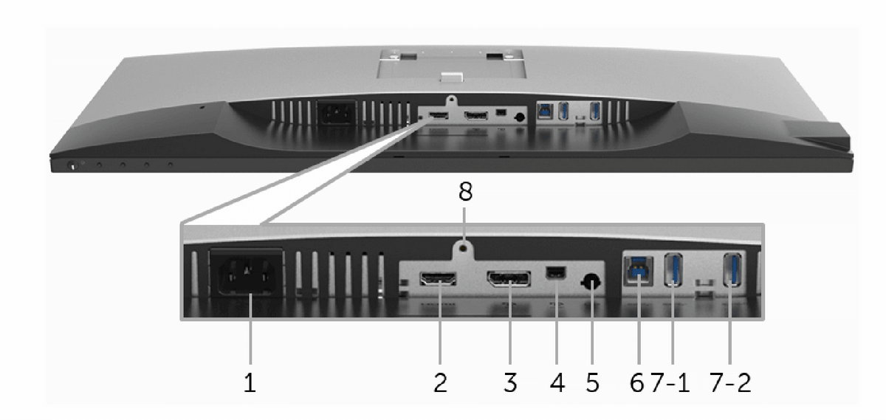

**Dell UltraSharp U2718Q**, a **27-inch 4K monitor** that quickly became an important part of my desk setup. What attracted me to this display was the combination of **3840 x 2160 resolution**, **IPS panel**, **60Hz refresh rate**, and **5 ms response time**. According to Dell’s user guide, the U2718Q offers a 27-inch viewable area, 4K UHD resolution, wide viewing angles, and support for **1.07 billion colors** [[1]](https://dl.dell.com/manuals/all-products/esuprt_display_projector/esuprt_display/dell-u2718q-monitor_user's-guide_en-us.pdf).

### Why I chose it

I wanted a monitor that would be suitable for:

- daily office work
- programming
- photo and content viewing
- sharp text rendering
- enough screen space for multiple windows

The **4K resolution** on a 27-inch panel gives a very crisp image, and the IPS technology helps with consistent colors and wide viewing angles. Dell also specifies strong color coverage, including **99.9% sRGB** and **99.9% Rec. 709**, which makes it a very solid all-round display for productivity and media consumption [[2]](https://www.officestationery.co.uk/documents/35799-EXR8DELLU2718Q.pdf).

### Main specifications

- **Model:** Dell UltraSharp U2718Q
- **Screen size:** 27 inch
- **Resolution:** 3840 x 2160
- **Panel type:** IPS
- **Refresh rate:** 60Hz
- **Response time:** 5 ms (fast mode), 8 ms (normal mode)
- **Aspect ratio:** 16:9
- **Brightness:** 350 cd/m²
- **Contrast ratio:** 1300:1
- **Viewing angles:** 178° / 178°
- **Color depth:** 1.07 billion colors [[1]](https://dl.dell.com/manuals/all-products/esuprt_display_projector/esuprt_display/dell-u2718q-monitor_user's-guide_en-us.pdf) [[2]](https://www.officestationery.co.uk/documents/35799-EXR8DELLU2718Q.pdf)

### Connectivity

One of the strong points of this monitor is its flexibility. The U2718Q includes:

- **DisplayPort**
- **Mini DisplayPort**
- **HDMI**
- **USB 3.0 hub**
- **audio line-out** [[1]](https://dl.dell.com/manuals/all-products/esuprt_display_projector/esuprt_display/dell-u2718q-monitor_user's-guide_en-us.pdf)

This made it easy to connect different systems over time, without constantly changing cables or adapters.

| Label | Description | Use |
|---|---|---|
| 1 | AC power connector | Connect the power cable. |
| 2 | HDMI port connector | Connect your computer with an HDMI cable. |
| 3 | DisplayPort in connector | Connect your computer with a DP cable. |
| 4 | Mini DisplayPort in connector | Connect your computer with a Mini-DP to DP cable. |
| 5 | Audio-Line out | Connect your speakers.* |
| 6 |USB upstream port | Connect the USB cable that came with your monitor to the computer. Once this cable is connected, you can use the USB connectors on the monitor. |
| 7-1 | USB downstream port | Connect your USB device. You can only use this connector after you have connected the USB cable to the computer and USB upstream connector on the monitor.** |
| 7-2 | USB downstream port with Power Charging | Connect to charge your device. |
| 8 | Stand lock feature | To lock the stand to the monitor using a M3 x 6 mm screw (screw not included). |

### Design and ergonomics

The monitor has the typical **Dell UltraSharp** look: clean, professional, and understated. It also supports ergonomic adjustments and **VESA mounting**, which is always useful for a cleaner desk setup or monitor arm installation [[1]](https://dl.dell.com/manuals/all-products/esuprt_display_projector/esuprt_display/dell-u2718q-monitor_user's-guide_en-us.pdf).

### Final thoughts

The **Dell U2718Q** turned out to be a very good purchase. It delivered exactly what I wanted: a sharp 4K image, good colors, modern connectivity, and a design that fits well in a work-focused environment.

For productivity and everyday use, this monitor has been a reliable choice.
