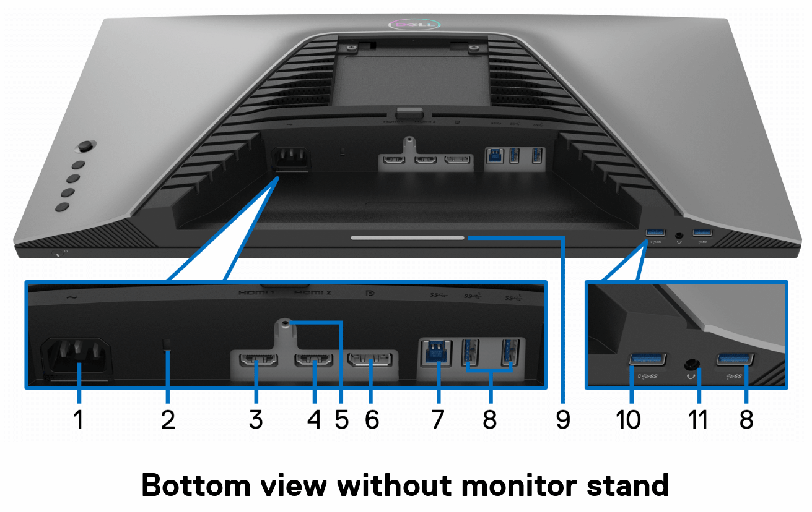

I bought the **Dell S2522HG**, a **24.5-inch Full HD gaming monitor** designed for speed and smooth gameplay. What made it attractive to me was the combination of **240Hz refresh rate**, **1 ms response time**, **Fast IPS panel**, and **99% sRGB color coverage**. According to Dell’s user guide, the monitor supports up to **240Hz**, includes ergonomic adjustments, and offers both **AMD FreeSync Premium** and **NVIDIA G-SYNC Compatible** support [[1]](https://dl.dell.com/manuals/all-products/esuprt_electronics_accessories/esuprt_electronics_accessories_monitor/dell-s2522hg-monitor_Users-Guide_en-us.pdf).

### Why I chose it

I wanted a monitor that would be suitable for:

- fast-paced gaming
- smooth motion clarity
- everyday desktop use
- good colors for an IPS gaming panel
- modern connectivity options

The **240Hz refresh rate** is the main highlight here, especially for competitive games where fluid motion matters. The **Fast IPS** panel is also a nice balance between speed and image quality, giving better colors and viewing angles than older TN-based gaming monitors [[1]](https://dl.dell.com/manuals/all-products/esuprt_electronics_accessories/esuprt_electronics_accessories_monitor/dell-s2522hg-monitor_Users-Guide_en-us.pdf) [[2]](https://content.ekatalog.biz/katalog/D-M-S2522HG/Dell-25-Gaming-Monitor-S2522HG-Reviewers-Guide_EU.pdf).

### Main specifications

- **Model:** Dell S2522HG
- **Screen size:** 24.5 inch
- **Resolution:** 1920 x 1080
- **Panel type:** Fast IPS
- **Refresh rate:** 240Hz
- **Response time:** 1 ms gray-to-gray (Extreme mode)
- **Color coverage:** 99% sRGB
- **Adaptive sync:** AMD FreeSync Premium, NVIDIA G-SYNC Compatible
- **Viewing angles:** 178° / 178°
- **Brightness:** 400 cd/m² [[3]](https://www.displayspecifications.com/en/model/a11526ff) [[1]](https://dl.dell.com/manuals/all-products/esuprt_electronics_accessories/esuprt_electronics_accessories_monitor/dell-s2522hg-monitor_Users-Guide_en-us.pdf)

### Connectivity

The Dell S2522HG comes with a practical set of ports:

- **2 x HDMI 2.0**
- **1 x DisplayPort 1.2**
- **USB upstream**
- **multiple USB downstream ports**
- **audio line-out / headphone out** [[1]](https://dl.dell.com/manuals/all-products/esuprt_electronics_accessories/esuprt_electronics_accessories_monitor/dell-s2522hg-monitor_Users-Guide_en-us.pdf)

This is useful if you want to connect both a PC and a console, while also using the monitor as a small USB hub.

| Label | Description | Use |
|---|---|---|
| 1 | Power connector | Connect the power cable (shipped with your monitor). |
| 2 | Security lock slot | Secure the monitor with a security lock (security lock not included). |
| 3 | HDMI port (HDMI 1) | Connect to your computer with the HDMI cable (shipped with your monitor). |
| 4 | HDMI port (HDMI 2) | Connect to your computer with the HDMI cable (shipped with your monitor). |
| 5 | Stand lock feature | Lock the stand to the monitor using an M3 x 6 mm screw (screw not included). |
| 6 | DisplayPort | Connect to your computer with the DisplayPort cable (shipped with your monitor). |
| 7 | SuperSpeed USB 5 Gbps (USB 3.2 Gen1) Type-B upstream port | Connect the USB cable (shipped with your monitor) from this port to your computer to enable the USB ports on your monitor. |
| 8 | SuperSpeed USB 5 Gbps (USB 3.2 Gen1) Type-A downstream port (3) | Connect your USB 3.2 Gen1 (5 Gbps) device. |
| 9 | Downlights | Turn the monitor downlights on or off. |
| 10 | SuperSpeed USB 5 Gbps (USB 3.2 Gen1) Type-A downstream port with Power Charging | Connect to charge your USB device. |
| 11 | Headphone out port | Connect the headphones to the monitor. |

### Design and ergonomics

Like many Dell displays, this one also offers solid ergonomics. The stand supports:

- **height adjustment**
- **tilt**
- **swivel**
- **pivot**

That makes it easy to position correctly on the desk, whether for gaming sessions or regular daily use [[1]](https://dl.dell.com/manuals/all-products/esuprt_electronics_accessories/esuprt_electronics_accessories_monitor/dell-s2522hg-monitor_Users-Guide_en-us.pdf).

### Final thoughts

The **Dell S2522HG** looks like a very good choice if you want a fast gaming monitor without giving up IPS image quality. The combination of **240Hz**, **1 ms response time**, and **adaptive sync support** makes it a strong option for competitive gaming, while the color performance keeps it pleasant for general use too.

For a Full HD high-refresh monitor, it offers a very balanced package.
